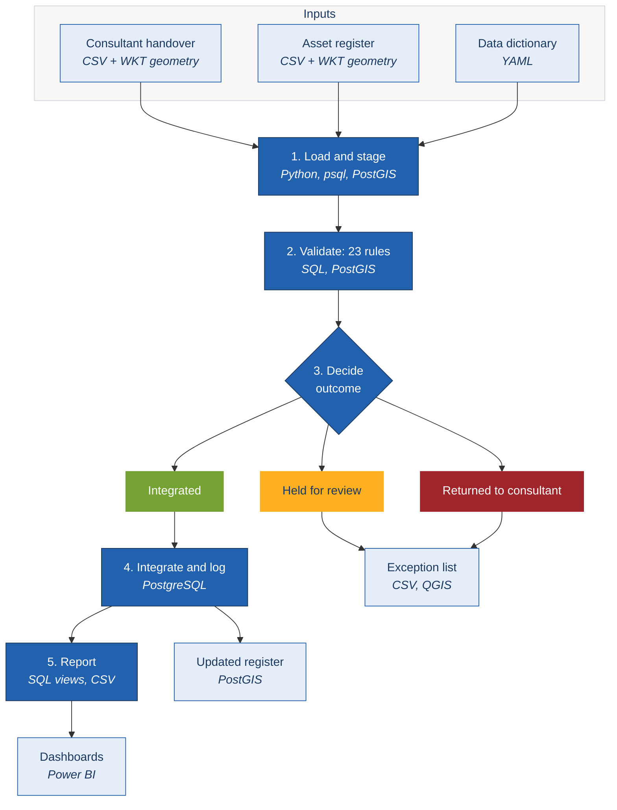
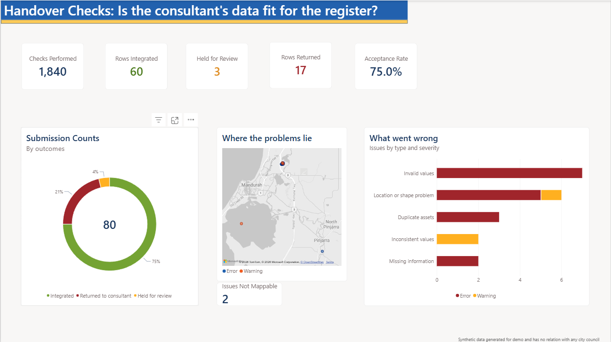
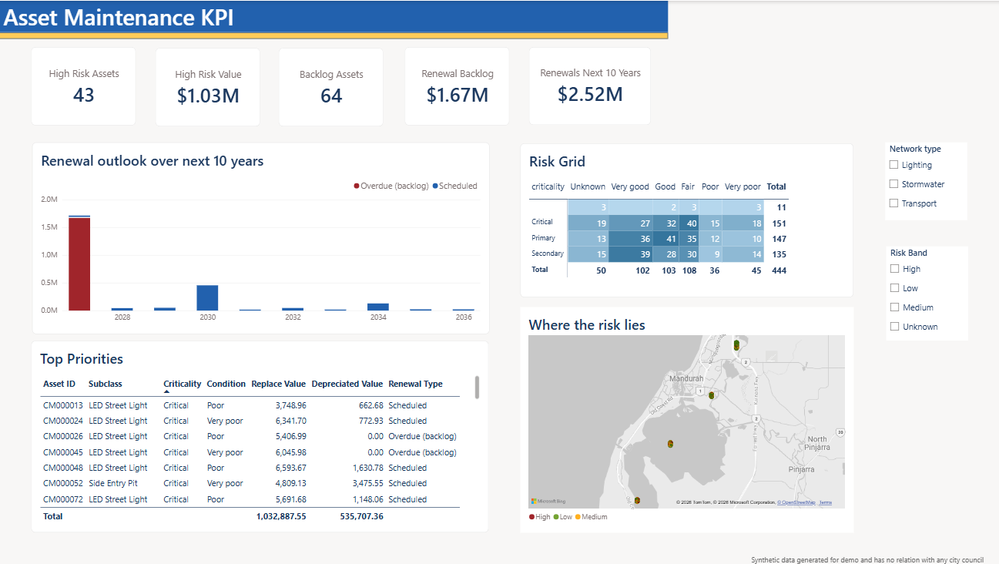

# Asset Data Handover Validation Pipeline

An automated pipeline that checks as-constructed asset data (roads, paths, drainage and street lights)
**before** it enters a local government asset register, then turns the results into Power BI dashboards
for the asset management team.

Western Australian councils receive as-constructed data from developers and consultants for every
subdivision and capital project, typically under the A-SPEC specifications. Checking that data by hand is
slow and inconsistent, and errors flow straight into valuations and renewal plans. This project automates
the check, records every decision, and reports the results in a form the team can act on.

All data is synthetic, in GDA2020 / MGA zone 50 (EPSG:7850), the projection used around Mandurah, WA.

## Why it matters

| Without automation | With this pipeline |
|---|---|
| Hours of manual checking per handover | Every row checked against 23 rules in seconds |
| Results depend on who does the checking | The same rules, applied the same way, every time |
| Errors are found after they reach the register | Errors are stopped at the door, with a reason for each |
| Little record of why data was accepted | Every decision is logged and auditable |
| Data quality is assumed | Data quality is measured and reported |

On the sample handover, one typo in a road-seal unit rate ($906.75/m² instead of $25-60) would have
overstated the register by about **$2.7M**. The pipeline caught it.

## How it works



1. **Load and stage**: reads the handover, register and reference data into PostGIS. Bad values are
   reported rather than breaking the load.
2. **Validate**: applies 23 rules driven by `config/data_dictionary.yaml`, for example missing attributes,
   invalid asset types, out-of-range unit rates, duplicate IDs, invalid geometry and assets outside the boundary.
3. **Decide**: each row is *Integrated* (no issues), *Held for review* (warnings only) or
   *Returned to consultant* (errors).
4. **Integrate**: clean rows are added to the register, and every decision is logged.
5. **Report**: views and CSV exports feed the Power BI dashboards.

## Dashboards

**Handover Checks: is the consultant's data fit for the register?**
Outcome of every row, what went wrong in plain English, and where the problems are on the map.



**Asset Maintenance KPI: what does clean data tell us?**
High-risk assets, renewal backlog, a 10-year renewal outlook, a risk grid (condition x criticality),
and a prioritised list of assets.



The report (`powerbi/asset_dashboard.pbix`) uses a simple star schema: one shared asset-type dimension
feeding the handover-check and asset-register fact tables, so one filter works across every page.
`powerbi/dashboard_build_guide.md` explains how to rebuild it step by step from the CSV exports.

## Results on the sample data

| Measure | Result |
|---|---|
| Rows in the handover | 80 |
| Automated checks performed | 1,840 (80 rows x 23 rules) |
| Integrated / held for review / returned | 60 / 3 / 17 |
| First-pass acceptance | 75% |
| Planted test errors caught | **20 of 20**, with no false alarms (also checked with other random seeds) |

The sample data contains 20 deliberately planted errors, so the rules can be tested against a known answer.

## Quick start

**Requirements**
- PostgreSQL 14+ with PostGIS 3. On Windows, install PostGIS through **Application Stack Builder**
  (*Spatial Extensions > PostGIS 3.x*).
- `psql` on your PATH, or the `PSQL` environment variable set to its full path
  (for example `C:\Program Files\PostgreSQL\18\bin\psql.exe`).
- Python 3.10+ with PyYAML: `pip install PyYAML`.
  (`requirements.txt` also lists Apache Airflow, which is only needed for the optional schedule in `dags/`.)
- Power BI Desktop, to open the report.

**1. Set the connection details** (PowerShell; on macOS/Linux use `export NAME=value`)

```powershell
$env:PGHOST = "localhost"; $env:PGPORT = "5432"; $env:PGUSER = "postgres"
$env:PGPASSWORD = "your-password"; $env:PGDATABASE = "assets"
```

Keep the password in your terminal session only; don't commit it.

**2. Create the database** (first run only; PostGIS is enabled by the first SQL script)

```bash
psql -d postgres -c "CREATE DATABASE assets;"
```

**3. Run the pipeline**

```bash
python src/run_pipeline.py --generate
```

This generates the sample data, runs the four SQL scripts in order and ends with the score:

```
Seeded errors detected: 20/20 (100%)
Rows flagged without a seeded error: 0
```

PostGIS notices such as *Too few points in geometry component* are expected: they come from the
deliberately invalid test geometry.

**4. Open the dashboards**: open `powerbi/asset_dashboard.pbix` in Power BI Desktop and click **Refresh**.
The report reads the CSV files in `output/`.

| Option | Default | Purpose |
|---|---|---|
| `--generate` | off | Regenerate the sample data before running |
| `--seed` | `42` | Random seed for the sample data |
| `--submission-ref` | `WAPC-123456 Stage 4` | Reference recorded against the handover |
| `--no-score` | off | Skip scoring (for real handovers, which have no planted errors) |

## Outputs

- `output/`: CSV files for Power BI, including `dq_exceptions.csv` (the exception list) and
  `rule_evaluation.csv` (each planted error and whether it was caught).
- `data/`: generated sample data and reference tables.
- The `am` schema in PostgreSQL. To view it in QGIS: *Layer > Add Layer > Add PostGIS Layers*.

`data/` and `output/` are recreated on each run and are not committed to the repository.

## Project structure

```
config/data_dictionary.yaml      asset hierarchy, valid values, unit-rate and useful-life ranges
src/generate_sample_data.py      synthetic register, handover and planted errors
src/run_pipeline.py              runs the SQL steps with psql and scores the results
sql/01_schema.sql                tables, indexes and safe-conversion functions
sql/02_load_and_stage.sql        loads reference data, boundary, register and handover
sql/03_validation_rules.sql      the 23 validation rules
sql/04_integrate_and_report.sql  outcomes, integration, reporting views and CSV exports
powerbi/                         Power BI report, DAX measures, theme and build guide
notebook/asset_register.ipynb    exploratory look at the input data
image/                           dashboard screenshots
dags/asset_dq_dag.py             optional Apache Airflow schedule
```

## Notes and limitations

- All data is synthetic and has no connection to any council. The boundary is a simplified rectangle,
  and unit rates and useful lives are illustrative.
- The rules are modelled on the kind of checks A-SPEC validation performs; they aren't an implementation
  of the A-SPEC specification itself.
- The renewal outlook is age-based, and the risk score is a simple condition x criticality rating.
  A full renewal model would also use condition-based deterioration and the council's own risk framework.
- The Airflow schedule is optional. Airflow doesn't run natively on Windows (use WSL or Docker).
